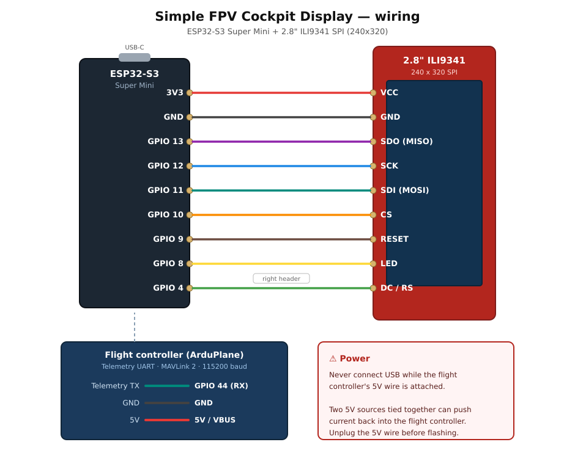

# Simple FPV Cockpit Display — ESP32-S3 + 2.8" ILI9341

**A MAVLink artificial horizon for ArduPilot planes, built to be filmed by your FPV camera.**

A tiny glass cockpit for the nose of your model. An ESP32-S3 reads MAVLink
telemetry from the flight controller and draws an attitude indicator, airspeed,
altitude above home, arm state and flight mode, with pop-up warnings for low
battery and low altitude. Everything is drawn thick and outlined so it stays
readable when a fixed-focus FPV camera films the screen from a few inches away.

Lettering is set in **[B612](https://b612-font.com/)** — the typeface Airbus and
ENAC designed for aircraft cockpit screens.

It is a fun, cosmetic build. It is **not** a flight instrument. See
[Disclaimer](#disclaimer).


*Bench test: a Matek F405-WING feeding an ESP32-S3 Super Mini over MAVLink,
driving a 2.8" ILI9341. Lettering is B612.*

---

## Credit where it's due

This is a port of **[Simple-FPV-Cockpit-Display](https://github.com/keithluneau/Simple-FPV-Cockpit-Display)**
by **Keith Luneau** ([Bonafidepirate](https://www.youtube.com/@bonafidepirate)),
which targets the LilyGo T-Display-S3 and its 8-bit parallel screen. The
concept, the screen layout, the warning logic and the MAVLink handling are his.

This version retargets it to a plain ESP32-S3 dev board driving a cheap 2.8"
ILI9341 **SPI** panel, and adds a few things along the way. MIT licensed, same
as the original. If you have a real T-Display-S3, **use Keith's original** — it
is already set up for that board.

---

## What it shows

| Element | Detail |
|---|---|
| **Artificial horizon** | Sky/ground, roll-following pitch ladder, bank ticks, fixed aircraft symbol |
| **Airspeed** | Left box, in km/h, m/s, mph or knots |
| **Altitude above home** | Right box, in metres or feet |
| **Status line** | `DISARMED - <mode>` on the ground, just the mode when armed, `Waiting for MAVLINK` if the link drops |
| **Warnings** | Blinking low-battery and low-altitude pop-ups, plus a steady 5-second `ARMED` notice |
| **Brightness** | Optionally driven from a spare R/C channel |
| **Demo mode** | A simulated flight on the BOOT button — no flight controller needed |
| **WiFi bridge** | Optional. Mission Planner over WiFi at the same time as the display |

### What's different from the original

- **SPI display driver.** A hand-written LovyanGFX config for ILI9341 instead of
  the LilyGo board profile, which drives a parallel panel.
- **B612 cockpit font**, bundled as generated headers — no extra install.
- **One-line unit switch** for metric / imperial / aviation units.
- **Attitude smoothing**, so the horizon glides between telemetry updates
  instead of stepping.
- **Faster horizon fill.** Rows the horizon doesn't cross are filled as solid
  blocks rather than one scanline at a time, which is most of the screen in
  near-level flight.
- **Plain PWM backlight** instead of the T-Display-S3's AW9364 pulse-counting chip.
- **WiFi MAVLink bridge**, so Mission Planner can talk to the aircraft over
  WiFi through the same board, without interrupting the display.
- 320×240 layout instead of 320×170.

---

## What you need

- An **ESP32-S3 dev board**. Developed on an ESP32-S3 Super Mini; any S3 works
  if you adjust the pins.
- A **2.8" 240×320 ILI9341 SPI module** (the common red "V1.2" board).
  The touch panel and SD slot are not used.
- A flight controller running **ArduPilot Plane** with a free telemetry UART.
  Flight-mode names are ArduPlane's, QuadPlane modes included.
- Three wires to the flight controller (four if you want the WiFi bridge),
  nine to the display.
- [Arduino IDE](https://www.arduino.cc/en/software) with ESP32 board support.

---

## Wiring



### Display → ESP32-S3

| Display pin | ESP32-S3 | Super Mini header |
|---|---|---|
| VCC | 3V3 | left |
| GND | GND | left |
| SDO (MISO) | GPIO 13 | left |
| SCK | GPIO 12 | left |
| SDI (MOSI) | GPIO 11 | left |
| CS | GPIO 10 | left |
| RESET | GPIO 9 | left |
| LED | GPIO 8 | left |
| DC / RS | GPIO 4 | **right** |

MISO is optional — set `TFT_MISO = -1` and leave it unconnected if you need the pin.

SCK, MOSI and MISO are the S3's native FSPI pins, so the hardware routes them
directly rather than through the GPIO matrix. On a Super Mini only GPIO 8–13 and
GND/3V3/5V come out on the left header, which is one pin short of what the
display needs — hence DC on GPIO 4, over on the right.

**Pins to avoid on an S3** if you rearrange anything: GPIO 0 and 3 (strapping),
19 and 20 (native USB), 26–32 (flash), 33–37 (octal PSRAM on R8 modules),
43 and 44 (UART0, used here for MAVLink), 45 and 46 (strapping), 48 (RGB LED).

### Flight controller → ESP32-S3

| Flight controller | ESP32-S3 |
|---|---|
| Telemetry TX | GPIO 44 (RX) |
| Telemetry RX | GPIO 43 (TX) &mdash; **only needed for the WiFi bridge** |
| GND | GND |
| 5V | 5V / VBUS |

> [!WARNING]
> **Do not power the board from USB while the flight controller's 5V is
> connected.** Two 5V sources tied together risk pushing current back into the
> flight controller. Unplug the 5V wire before connecting USB to flash or bench-test.

Most of these display modules have a level shifter and tolerate 5V logic, but
some do not. If there's no 74HC245 or similar on the back, feed it 3V3 — which
is what the S3 drives anyway.

---

## Installing

1. **ESP32 board support.** In *File → Preferences*, add to
   *Additional boards manager URLs*:
   `https://espressif.github.io/arduino-esp32/package_esp32_index.json`
   Then *Tools → Board → Boards Manager*, search `esp32`, install
   **esp32 by Espressif Systems**.

2. **Libraries** (*Tools → Manage Libraries*):
   - **LovyanGFX** (by lovyan03)
   - **MAVLink** — the one by **Oleg Kalachev**. Several MAVLink libraries exist;
     this sketch's `#include <MAVLink.h>` matches that one.

   The B612 font headers ship with the sketch, so there is nothing else to install.

3. **Open the sketch.** Download this repository and open
   `Cockpit_Display_S3/Cockpit_Display_S3.ino`. Keep the `.ino` in a folder of
   the same name, and keep the three `B612Bold*.h` files beside it.

4. **Board settings** (*Tools*):

   | Setting | Value |
   |---|---|
   | Board | ESP32S3 Dev Module |
   | USB CDC On Boot | **Enabled** |
   | CPU Frequency | 240 MHz |
   | Flash Size | whatever your board has |
   | PSRAM | **QSPI PSRAM** on a Super Mini (ESP32-S3FH4R2), **OPI PSRAM** on an R8 module, otherwise **Disabled** |
   | Partition Scheme | Default |

   *USB CDC On Boot: Enabled* routes the debug `Serial` to USB and leaves
   hardware UART0 (GPIO 43/44) free for MAVLink on `Serial1`. With it disabled,
   the two fight over those pins.

   Picking the wrong PSRAM mode can hang the board at boot. **Disabled** always
   works — the sketch detects PSRAM at runtime and uses SRAM either way.

5. **Review the settings** at the top of the sketch, especially `UNIT_SYSTEM`
   and the warning limits.

6. **Flash over USB only**, with the flight controller's 5V wire unplugged.

7. **Press BOOT** to run demo mode and confirm the display works before wiring
   anything to the aircraft.

---

## ArduPilot setup

Set the telemetry port to MAVLink 2 at 115200 baud (`SERIALn_PROTOCOL = 2`,
`SERIALn_BAUD = 115`), then set the stream rates for that port.

On ArduPilot 4.7 and newer the stream parameters are `MAVn_...`, where *n*
counts the serial ports set to MAVLink (`MAV1` is the first). Older versions
used `SRn_...`, numbered from 0, e.g. `SR0_EXTRA1`.

| Parameter | Suggested | Message | Drives |
|---|---|---|---|
| `MAVn_EXTRA1` | **25 Hz** | `ATTITUDE` | the horizon |
| `MAVn_EXTRA2` | 4 Hz | `VFR_HUD` | airspeed |
| `MAVn_POSITION` | 4 Hz | `GLOBAL_POSITION_INT` | altitude above home |
| `MAVn_EXT_STAT` | 2 Hz | `SYS_STATUS` | battery voltage |
| `MAVn_EXTRA3` | 2 Hz | `BATTERY_STATUS` | battery voltage (either this or `EXT_STAT`) |
| `MAVn_RC_CHAN` | 10 Hz | `RC_CHANNELS` | only if brightness is on an R/C channel |

**`MAVn_EXTRA1` is the one that matters for smoothness.** The display redraws far
faster than 10 Hz, so a 10 Hz attitude stream is what you actually see. Raising
it to 20–25 Hz does more for the feel of the horizon than any other change.

Keep every stream you use at 1 Hz or faster, or its readout shows `---`. The
heartbeat, which carries arm state and flight mode, is always sent. Altitude is
relative to home, so it needs a GPS fix. Airspeed is whatever ArduPilot reports
in `VFR_HUD`; without an airspeed sensor that is an estimate.

---

## Settings

Everything you are likely to change is in the **USER SETTINGS** block at the top
of the sketch, and every setting carries its default in a comment.

### Units — one line

```cpp
#define UNIT_SYSTEM  UNITS_METRIC
```

| Value | Speed | Altitude | Low-altitude warning |
|---|---|---|---|
| `UNITS_METRIC` | km/h | metres | 15 m |
| `UNITS_IMPERIAL` | mph | feet | 50 ft |
| `UNITS_AVIATION` | knots | feet | 50 ft |
| `UNITS_CUSTOM` | your choice | your choice | your choice |

Changing this moves the speed unit, the altitude unit **and** the warning limit
together, so you can't end up warning at 50 metres because the number was
written for feet.

### The ones most people touch

| Setting | Default | What it does |
|---|---|---|
| `UNIT_SYSTEM` | `UNITS_METRIC` | see above |
| `ATTITUDE_LEAD_MS` | `60` | forward prediction, in ms. Cancels pipeline latency. `0` = off |
| `ATTITUDE_SMOOTHING` | `0.50` | horizon easing. `1.0` = off, `0.15` = very smooth and laggy |
| `ATTITUDE_DEADBAND_DEG` | `0.25` | ignore attitude changes below this. Stops the horizon shivering on gyro noise |
| `WARN_PACK_V` | `13.2` | low-battery warning, total pack volts. `0` disables |
| `ARMED_NOTICE_MS` | `5000` | how long the `ARMED` pop-up shows. `0` disables |
| `BRIGHT_RC_CHANNEL` | `0` | R/C channel (1–18) controlling brightness. `0` disables |
| `TFT_SPI_FREQ` | `40000000` | SPI clock. `80000000` is faster but depends on your wiring |
| `WIFI_BRIDGE_ENABLE` | `true` | WiFi MAVLink bridge. `false` = display only, no radio |
| `WIFI_BRIDGE_MODE` | `BRIDGE_AP` | `BRIDGE_AP` makes its own network, `BRIDGE_STA` joins yours |
| `WIFI_SSID` / `WIFI_PASS` | `cockpit-display` / `fpvcockpit` | Network name and password. Change them |
| `WIFI_UDP_PORT` | `14550` | MAVLink standard; what Mission Planner expects |
| `WIFI_FLUSH_MS` | `10` | Telemetry batching window. Affects the ground station only |
| `PITCH_PIXELS_PER_DEGREE` | `5.0` | pitch scale. Higher = more sensitive |
| `TEXT_OUTLINE` | `2` | black outline around text over the scene. `0` = solid box instead |
| `OUTLINE` | `3` | black outline around every marking |
| `SKY`, `GROUND` | — | RGB565 colors |

Text that would run off the screen shrinks to the next font size automatically.

---

## The font

Most "cockpit" fonts are either proprietary or just a squared-off sci-fi face.
**B612** is the real thing: designed by Airbus with ENAC and the Université de
Toulouse specifically for aircraft cockpit screens, and released under the SIL
Open Font License. It is drawn to stay unambiguous under vibration and poor
light — which is close to the problem an FPV camera filming a small LCD has.

Three sizes are bundled as generated headers:

| Header | Size | Used for |
|---|---|---|
| `B612Bold28.h` | 28 px/em, 21 px digits | readouts, flight mode, warning box |
| `B612Bold20.h` | 20 px/em, 15 px digits | disarmed status line, DEMO tag |
| `B612Bold16.h` | 16 px/em, 12 px digits | auto-shrink fallback |

To regenerate at another size, grab `B612-Bold.ttf`
([Google Fonts](https://fonts.google.com/specimen/B612) or
[polarsys/b612](https://github.com/polarsys/b612)) and run:

```bash
python3 tools/ttf2gfx.py B612-Bold.ttf 32 B612Bold32 > Cockpit_Display_S3/B612Bold32.h
```

Then `#include` it and point `FONT_LARGE` at `&B612Bold32`. The converter needs
only Pillow, and emits the Adafruit-GFX layout LovyanGFX accepts. It works for
any TTF, so swap in whatever you like.

Validate a generated header before flashing it:

```bash
python3 tools/check_font_header.py Cockpit_Display_S3/B612Bold32.h
```

It reads the file the way a C compiler does — applying line continuations and
stripping comments first — then checks the glyph count and that every
`bitmapOffset` matches the packed sizes. This matters: a `\` left at the end of
a comment is a line continuation that silently swallows the next glyph, and the
only symptom is text rendering one character off.

Prefer not to bundle fonts at all? LovyanGFX's built-ins work too — set
`FONT_LARGE` to `&fonts::FreeSansBold18pt7b` and drop the includes.

---

## Performance

The display redraws a full 320×240 frame into an off-screen buffer and pushes it
over SPI. Reported over USB serial once a second, along with the live `ATTITUDE`
rate:

```
ATTITUDE 25 Hz | roll -3.2 pitch 1.8 | 31 fps, 18.4 ms/frame
```

If it feels slow:

1. **Raise `MAVn_EXTRA1` to 25–50 Hz.** Almost always the real culprit — the
   screen can only show new attitudes as fast as they arrive.
2. **Check `USE_PSRAM` is `false`.** The S3's PSRAM is far slower to draw into
   than its SRAM, and the 150 KB buffer fits in SRAM comfortably.
3. **Try `TFT_SPI_FREQ = 80000000`.** At the 40 MHz default, pushing one frame
   is ~31 ms of bus time on its own, so 80 MHz roughly halves it. It is past
   the ILI9341's specified limit though, so watch for torn pixels or a sideways
   jitter and come back to 40 MHz if you see any.
4. **Lower `ATTITUDE_SMOOTHING`** toward `1.0` if the easing feels like lag
   rather than smoothness.

---

## WiFi bridge — Mission Planner over the air

Optional, on by default, and independent of the display: the board forwards
raw MAVLink both ways between the flight controller's serial port and a UDP
socket, so a ground station can connect over WiFi while the cockpit display
carries on. Bytes are passed through untouched, so MAVLink 2, signing and any
dialect all work.

> [!IMPORTANT]
> **The bridge needs one extra wire.** The display only ever listens, so a
> display-only build needs just the flight controller's TX. A ground station
> has to talk back, so the board's TX must reach the flight controller's RX:
> **GPIO 43 &rarr; telemetry RX**. Without it you still get live telemetry in
> Mission Planner, but it sits at "getting params" forever and you cannot
> change anything on the aircraft.

### Connecting (AP mode, the default)

1. Power up the board. It creates a WiFi network called **`cockpit-display`**,
   password **`fpvcockpit`** &mdash; change both in the sketch.
2. Join that network from your laptop. The board is at **192.168.4.1**.
3. In Mission Planner pick **UDP** from the connection dropdown, leave the port
   at **14550**, and press **Connect**.

The board broadcasts telemetry until a ground station speaks to it, then sends
directly to that address, so Mission Planner finds it without being told an IP.

Set `WIFI_BRIDGE_MODE` to `BRIDGE_STA` to join an existing network instead,
which is handier at the bench because your laptop keeps its internet
connection. Watch the USB serial output for the address it gets. If it cannot
join within `WIFI_STA_TIMEOUT_MS` it gives up and runs as a plain display.

### Reading the status tag

Top right of the screen, when `WIFI_SHOW_STATUS` is on:

| Tag | Colour | Meaning |
|---|---|---|
| `WIFI` | yellow | Bridge up, no ground station has called in yet |
| `GCS` | cyan | A ground station is actively talking to the board |
| `NO WIFI` | red | WiFi never came up; the display runs as normal |

### Why it doesn't disturb the display

- **Memory.** The 150 KB frame buffer is allocated *before* WiFi starts, so it
  gets first claim on the one large contiguous block it needs. Everything
  together comes to roughly half of the S3's 512 KB.
- **Blocking writes.** Writing to a serial port stalls once the hardware FIFO
  fills &mdash; about 9 ms per 100 bytes at 115200, easily long enough to freeze
  a frame. The bridge checks `availableForWrite()` first and sends a datagram
  only if all of it fits, so it never blocks. A datagram that will not fit is
  dropped whole rather than half-written, because a truncated one would corrupt
  the byte stream the flight controller is parsing; MAVLink expects loss and the
  ground station retries. Drops are reported on USB serial as `[UPLINK DROPS]`.
- **The frame blackout.** Nothing is read off the serial port for the ~25 ms it
  takes to push a frame, so the receive buffer has to cover it. It is set to
  8192 bytes: 711 ms at 115200, 89 ms at 921600. The Arduino default of 256
  would be 22 ms and 3 ms respectively, and would drop bytes.
- **Batching.** Telemetry is gathered for up to `WIFI_FLUSH_MS` and sent as one
  UDP packet, which cuts the packet rate roughly 25-fold versus sending each
  short read. It adds that much latency to the ground station and none to the
  display.
- **Cores.** WiFi runs on core 0, the Arduino loop on core 1, so the radio is
  not competing with the drawing.

### Before you fly with it

- **Set a password.** An open network lets anyone in range command your
  aircraft. The default has one; keep it or change it, but do not blank it.
- **Check your current budget.** WiFi adds roughly 100&ndash;200 mA in bursts.
  If the board browns out and resets mid-flight you lose the display, so make
  sure the 5V supply has headroom.
- **Know your local rules.** Running a WiFi AP on an aircraft is not legal
  everywhere, and 2.4 GHz WiFi sits right on top of some R/C control links.
  Range-test on the ground before trusting it in the air.
- Set `WIFI_BRIDGE_ENABLE` to `false` for the display-only build, with no radio
  powered at all.

## Latency

The gap between the aircraft moving and the screen moving is the sum of a lot
of small delays — waiting for the next ATTITUDE message, the serial link, the
frame, pushing it over SPI, and the panel's own pixel response. Left alone it
lands somewhere around 80–120 ms, which is noticeable once you look for it.

**Forward prediction** removes most of it. Every ATTITUDE message carries the
angular rates along with the angles, so the sketch projects the last known
attitude forward along those rates by the age of the message plus
`ATTITUDE_LEAD_MS`. Instead of showing where the aircraft *was*, it estimates
where it *is*. Simulated against a 0.3 Hz roll at 25 Hz telemetry:

| Setting | Effective latency |
|---|---|
| `ATTITUDE_LEAD_MS = 0`, `ATTITUDE_SMOOTHING = 0.35` | 116 ms |
| `ATTITUDE_LEAD_MS = 0`, `ATTITUDE_SMOOTHING = 1.0` (no filter) | 50 ms |
| **`ATTITUDE_LEAD_MS = 60`, `ATTITUDE_SMOOTHING = 0.50`** (default) | **8 ms** |
| `ATTITUDE_LEAD_MS = 90` | &minus;22 ms (the horizon leads the aircraft) |

Prediction is an estimate, so too much of it overshoots. Stopping a 60&deg;/s
roll dead: the default overshoots by nothing measurable, while a deliberately
excessive `150` overshoots 4&deg; (about 11 px) and settles back over 134 ms.
If you ever see the horizon run past and rebound when you stop a roll, lower
`ATTITUDE_LEAD_MS`. `ATTITUDE_MAX_LEAD_MS` caps how far ahead it will ever
project, so a telemetry hiccup mid-manoeuvre cannot send it far wrong.

Three more things worth doing, in order of payoff:

1. **Raise `MAVn_EXTRA1` to 50 Hz.** Halves the wait for the next message
   compared with 25 Hz, and gives prediction less distance to cover. ATTITUDE
   at 50 Hz is about 2 kB/s, comfortable within 115200 baud.
2. **Raise `SERIALn_BAUD` to 921 (921600).** Costs nothing, and removes any
   queuing behind the other streams. The ESP32 handles it easily.
3. **Try `TFT_SPI_FREQ = 80000000`.** Halves the ~31 ms it takes to push a
   frame. Watch for torn pixels or sideways jitter and go back to 40 MHz if
   they appear.

The serial output reports the measured stream rate, the age of the newest
ATTITUDE message and the current roll rate, so you can see the effect directly:

```
ATTITUDE 50 Hz (age 12 ms) | roll -3.2 (-14 dps) pitch 1.8 | 30 fps, 18.4 ms/frame
```

## Troubleshooting

| Symptom | Check |
|---|---|
| Blank screen | Wiring, and `TFT_SPI_FREQ` down to `40000000`. Does the backlight come on at all? |
| Torn or speckled pixels | `TFT_SPI_FREQ` to `40000000`; keep the wires short |
| Picture shivers left and right | See below |
| Horizon overshoots and rebounds when you stop a roll | Lower `ATTITUDE_LEAD_MS` |
| Horizon feels laggy | See [Latency](#latency) |
| Sky orange, ground blue | Flip `TFT_INVERT` |
| Red and blue swapped | Set `cfg.rgb_order = true` in the `LGFX` class |
| Board hangs at boot | Wrong PSRAM mode. Set PSRAM to **Disabled** |
| `Waiting for MAVLINK` | Telemetry TX on GPIO 44, common ground, port set to MAVLink 2 at `MAV_BAUD` |
| Mission Planner stuck at "getting params" | The GPIO 43 &rarr; telemetry RX wire is missing |
| `NO WIFI` tag on screen | AP failed to start, or STA could not join. Check USB serial |
| No WiFi network appears | `WIFI_BRIDGE_ENABLE` is `true`? Password is 8+ characters? |
| Mission Planner will not connect | Laptop joined the board's network? UDP, port 14550? Firewall? |
| `[UPLINK DROPS]` on serial | Serial port saturated upstream. Raise `SERIALn_BAUD` on the flight controller |
| Board resets when WiFi starts | 5V supply cannot take the radio's current draw |
| A readout shows `---` | That stream is enabled at 1 Hz or faster. Altitude also needs a GPS fix |
| Text sits high or low in its box | Adjust `TEXT_Y_NUDGE` by a pixel or two |
| Flight mode shows `MODE n` | Not an ArduPlane mode the sketch knows, or not a plane |
| Brightness won't change | `BRIGHT_RC_CHANNEL` isn't 0, `MAVn_RC_CHAN` is on, endpoints match your radio |
| Nothing on USB serial | *USB CDC On Boot* must be **Enabled** |
| `redefinition of ...` when compiling | Two `.ino` files in the same folder. Arduino compiles them all as one |

### The picture shivers left and right

A horizontal shimmer of a pixel or several, most obvious when the aircraft is
standing still. Press **BOOT** for demo mode to tell the two causes apart,
because demo attitude is a clean mathematical curve with no noise in it.

**Still shivers in demo mode** &rarr; it is the SPI link. Set
`TFT_SPI_FREQ = 40000000`, shorten the wires, and make sure the display's ground
returns to the board by a short, direct path. At 80 MHz a long dupont jumper can
drop or add a bit mid-frame, which shifts the rest of that frame sideways.

**Steady in demo mode** &rarr; it is gyro noise reaching the horizon. The
horizon line is drawn from endpoints 320 px either side of centre, so a couple
of tenths of a degree of noise moves its visible ends by a pixel or more, and
the panel scanning out while the next frame is written turns that into a seam.
Raise `ATTITUDE_DEADBAND_DEG` to `0.4` or `0.6`. You will not notice it in
flight; a 60&deg;/s roll still tracks within about three pixels.

### Filming it

- **Focus.** Most FPV cameras are fixed-focus at infinity, so a screen a few
  inches away is soft. That's why everything is thick and outlined. A magnifier
  lens sharpens it, at the cost of mounting work, drag and glare.
- **Sun.** A small LCD can't beat direct midday sun. It reads well in the
  evening or under overcast. A hood around the screen helps.

---

## Disclaimer

This is a cosmetic, for-fun display. Do not use it as a flight instrument, and
do not rely on it for navigation or flight safety. Provided as is, without
warranty. Fly safely and within the rules where you live.

---

## License

- **Code:** [MIT](LICENSE). Original © Keith Luneau; port © its contributors.
- **B612 font:** [SIL Open Font License 1.1](docs/OFL.txt),
  © 2012 The B612 Project Authors. The generated `B612Bold*.h` headers are font
  software and remain under the OFL; the OFL text is included as required.

## Credits

- **Original project, concept and design:** Keith Luneau
  ([Bonafidepirate](https://www.youtube.com/@bonafidepirate)) —
  [Simple-FPV-Cockpit-Display](https://github.com/keithluneau/Simple-FPV-Cockpit-Display)
- **Graphics:** [LovyanGFX](https://github.com/lovyan03/LovyanGFX) by lovyan03
- **MAVLink:** [mavlink-arduino](https://github.com/okalachev/mavlink-arduino) by Oleg Kalachev
- **Font:** [B612](https://github.com/polarsys/b612) by Airbus, ENAC and the Université de Toulouse
- The aircraft symbol is styled after the one in the "Clash Bonafide" HD FPV font
  from [SneakyFPV](https://sites.google.com/view/sneaky-fpv/home)
